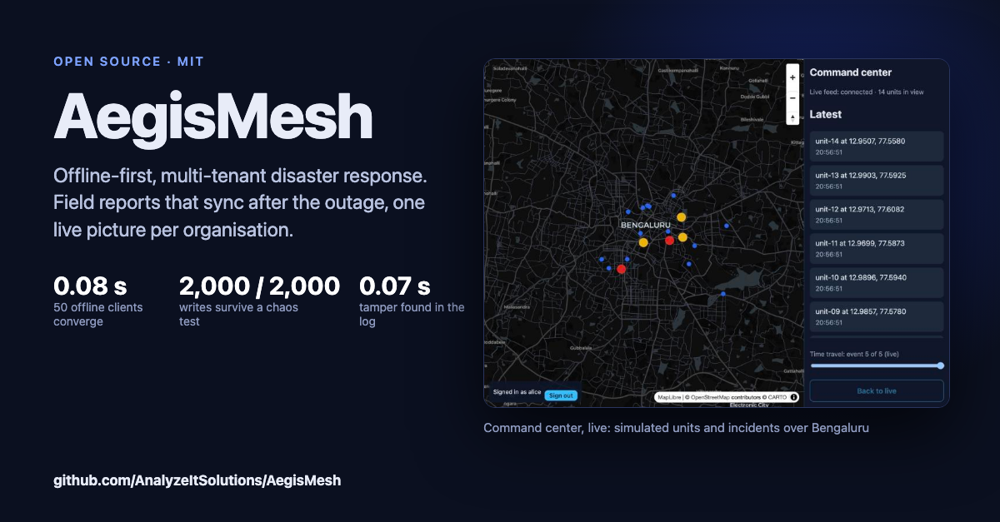
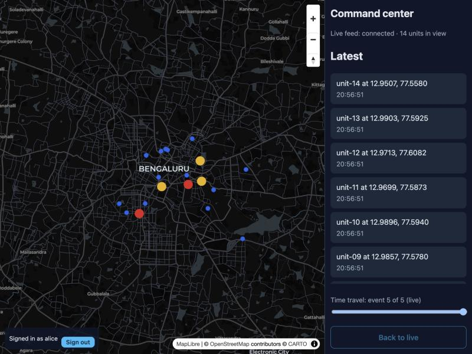
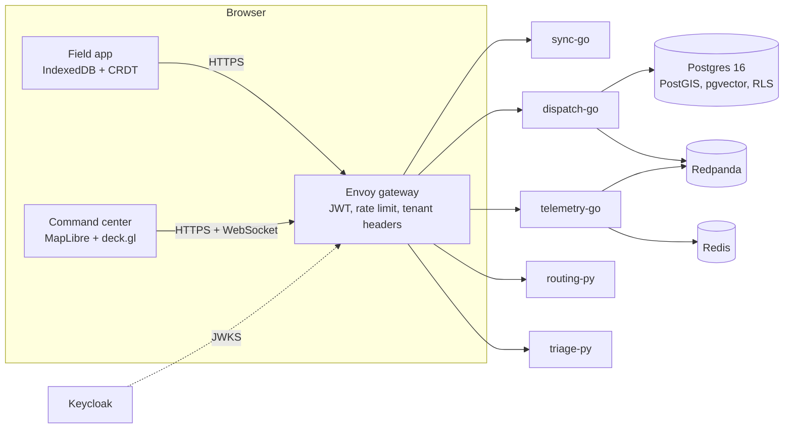

<p align="center"></p>

# AegisMesh

[](LICENSE)   

An offline-first, multi-tenant disaster-response platform: field responders report incidents with no connection, a command center watches rescue units move live on a map, every dispatch decision is written to a tamper-evident log, and one gateway keeps each organisation's data away from everyone else's.



*The command center against the real stack, driven by `make demo`: live unit positions over WebSocket, incidents from the event log, a time-travel slider over that log.*

## Try it

Needs Docker, Go, Node 20+ and Python 3.

```bash
make setup   # Python environment (stubs, tests)
make demo    # Postgres, Redis, Redpanda, Keycloak, Envoy gateway, three Go services, the web app, and a simulated fleet
```

Open <http://localhost:3000>, sign in as `alice` / `alice-dev` (tenant A). `bob` / `bob-dev` belongs to tenant B and never sees alice's data. Ctrl-C stops everything. These are development credentials in a local Keycloak realm.

## What it does

| | |
|---|---|
| **Field app** (`/field`) | Works with no connection. Reports are kept on the device (IndexedDB) and merge into the shared state when the network returns, using a CRDT (LWW registers, add/remove sets, hybrid logical clocks). |
| **Command center** (`/command`) | Live unit positions (H3 cell fan-out over WebSocket, Redis), incidents, and a time-travel slider that replays the real event log. |
| **Dispatch** | Event-sourced. Every command is appended to a per-tenant hash chain in Postgres; a full walk finds a one-character tamper. Commands are published to Redpanda through an outbox with a durable per-tenant cursor. |
| **Routing** | OR-tools vehicle routing over straight-line travel times; re-optimises, avoiding edges that cross a hazard polygon, when one is added. |
| **Triage** | START classification (Black / Red / Yellow / Green) and duplicate detection by H3 cell (and touching cells), time window and cosine similarity of report embeddings (an in-memory index; the pgvector extension is installed in Postgres but not yet used for this). Model calls are behind a flag, off by default. |
| **Gateway** | Envoy validates the Keycloak JWT, copies the `tenant_id` and subject claims into headers the services trust, and strips any such headers a client sends. Rate limited. Row-level security in Postgres is the second wall. |
| **Sign-in** | Authorization code flow with PKCE, token renewal before expiry, sign-out. |



## Measured (this machine, in-process stack)

Run with `bash bench/<name>.sh`. These measure the services in-process, not a deployed cluster, so treat them as upper-bound design checks, not capacity claims.

| Target | Result |
|---|---|
| 50 offline clients, 1,000 conflicting edits, 20% packet loss: one identical state hash | **0.08 s** (limit 10 s) |
| SOS to map, p99 | **0.25 ms** in-process (limit 150 ms; the network adds to this) |
| 50 vehicles x 200 incidents re-optimised after a hazard | **1.15 s** (limit 3 s) |
| Hash-chain walk finds a one-character tamper | **0.07 s** (limit 1 s) |
| Chaos: kill Redpanda, then SIGKILL dispatch, under steady load | **2,000 of 2,000** acknowledged writes in Postgres and on the topic, chain verifies (`scripts/chaos/zero_drop.sh`) |

Also verified for real: all migrations and row-level security against Postgres 16 with a non-superuser; gateway security (`scripts/gateway_check.py`, 18 checks: no token, garbage token, damaged signature, spoofed tenant header, cross-tenant reads, WebSocket token, CORS); the browser flows (sign in through Keycloak, field report syncing through the gateway, live units, time travel, tenant isolation).

A bug the chaos test found: Redpanda's dev-container mode caches writes, so a killed broker lost acknowledged messages. The compose file now turns write caching off.

## What is not done (honestly)

- **No cloud deployment.** The Terraform (network, Postgres, EKS, managed Redpanda) and Kubernetes manifests are written but have never been planned or applied against an account.
- **Service worker** (offline app shell) is tested in simulation, not in a real browser run.
- **mTLS between services** is not implemented; services trust the gateway's headers on a private network.
- **Speech-to-text and image severity** need model weights/keys that are not in the repo; **road routing** is straight-line distance, not a regional OSM road network; **60 FPS** and **10,000 concurrent users** are not measured.
- The outbox is at-least-once: a crash between publishing and saving the cursor republishes one event, so consumers dedupe on `tenant_id + sequence_id`.
- The demo basemap is CARTO's free dark style (OpenStreetMap data); set `NEXT_PUBLIC_MAP_STYLE` for your own tiles.

## Layout

`apps/web` Next.js app · `services/{sync-go,dispatch-go,telemetry-go,routing-py,triage-py}` · `proto/` contracts (Go and Python stubs are generated, never hand-written) · `db/migrations` · `infra/` (Envoy, Keycloak realm, Terraform, k8s, k6, OpenTelemetry, Prometheus, Toxiproxy) · `scripts/` (demo, simulator, chaos, gateway and stack checks, acceptance).

`make test` runs every service's tests; `bash scripts/acceptance.sh` runs the full acceptance pass.

## How it was built

Generated from a one-page brief by an open-source staged project builder (rules and templates first, a model only for the code that needs judgement), then hardened by hand against the real stack. The brief is `BRIEF.md`.

## License

MIT, see [LICENSE](LICENSE).
