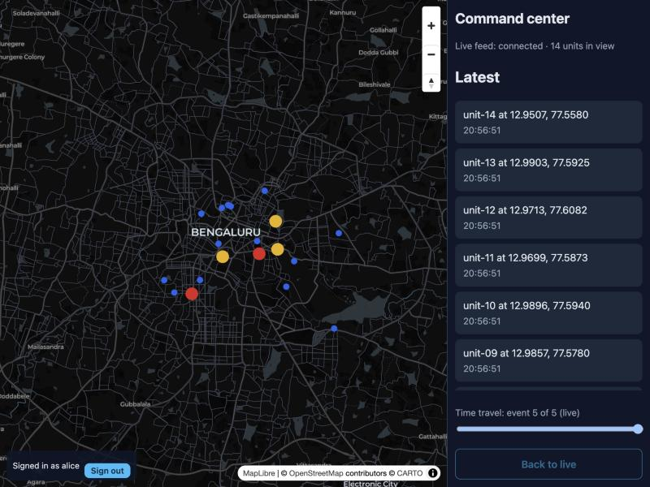

# AegisMesh: an offline-first disaster-response platform

*Case study for the website. Figures are from this repository's own scripts; see the README for what is and is not verified.*

**The problem.** When a flood cuts the network, responders still need to report, and a command center still needs one trustworthy picture, for each organisation separately.

**The build.** A one-page brief became five services (Go and Python), a Next.js app, Postgres with row-level security, Redpanda, Redis, Keycloak and an Envoy gateway, generated by a staged builder and then hardened against the real stack.

**Results (in-process, this machine).**
- 50 offline clients, 1,000 conflicting edits, 20% packet loss converge to one identical state in 0.08 s.
- A full hash-chain walk finds a one-character tamper in 0.07 s.
- 50 vehicles x 200 incidents re-optimised in 1.15 s after a hazard.
- Chaos test: 2,000 of 2,000 acknowledged writes survive a broker kill and a service SIGKILL.

**What verification found.** A broker setting that lost acknowledged messages, a sync cursor that could skip late edits, and a gateway config with no token check. Each is now a test.

**Honest limits.** Not deployed to a cloud, no mTLS between services, offline app shell tested in simulation only.

